<div align="center">


# 🌿 EcoBounty
### **SEE WASTE DIFFERENTLY. · MAKE BETTER CHOICES. · GROW A GREENER FUTURE.**

<p>
  
  
  
  
</p>

**AI brain. Real-world hardware. Planet-first thinking.** ♻️  
*A sustainability prototype exploring how smarter recognition can make waste sorting feel clearer, more interactive, and more rewarding.*

<p>
  <a href="#-the-big-picture">Explore the system</a> ·
  <a href="#-the-good-stuff">Features</a> ·
  <a href="#-get-it-running">Get started</a> ·
  <a href="#-the-road-ahead">Roadmap</a>
</p>

</div>

---

## ✦ THE MISSION

> **Make the greener choice the easier choice.**

EcoBounty brings a physical prototype and a web experience into one sustainability experiment. An **ESP32-CAM (OV3666)** captures images, a vision model accessed through **OpenRouter** helps interpret what the camera sees, and an **Arduino UNO** provides pushbutton input and serial communication.

The website is the digital home for the project: a place to present the experience, explain the workflow, and grow connected features as they are implemented. The long-term idea is simple—turn an everyday eco-action into something understandable, engaging, and worth repeating.

<div align="center">


<sub>Every stage should be understandable, testable, and honest about what the AI can—and cannot—tell you.</sub>

</div>

## 🚀 THE GOOD STUFF

<table>
<tr>
<td width="50%" valign="top">

### 🧠 AI-assisted vision

Images captured by the ESP32-CAM can be sent through the OpenRouter vision workflow for an AI interpretation.

**Why it matters:** a camera-based workflow can respond to real objects, not just a pre-filled demo screen.

</td>
<td width="50%" valign="top">

### 📷 Hardware that actually exists

EcoBounty combines a camera board with an Arduino UNO, a physical pushbutton, and serial communication.

**Why it matters:** the interaction connects software with an actual prototype.

</td>
</tr>
<tr>
<td width="50%" valign="top">

### 🌐 A web home for the project

The website gives EcoBounty a place to explain its purpose and present its interface as the connected experience develops.

**Why it matters:** hardware is more useful when people can understand what it is doing.

</td>
<td width="50%" valign="top">

### 🧩 Designed to grow

The current concept leaves room for a small I²C OLED, improved feedback, and optional connected services where configured.

**Why it matters:** add capabilities one verified step at a time instead of building a fragile pile of features.

</td>
</tr>
</table>

<div align="center">

| 📸 REAL-WORLD INPUT | 🧠 AI-ASSISTED INSIGHT | 🌱 HUMAN-LED IMPACT |
|:---:|:---:|:---:|
| Capture an image | Interpret the image | Use judgement and sort responsibly |

</div>

## 🧭 THE BIG PICTURE

```mermaid
flowchart LR
    U([Pushbutton / user action]) --> A[Arduino UNO]
    A <-->|Serial messages| C[ESP32-CAM · OV3666]
    C --> I[Capture image]
    I --> V[OpenRouter vision model]
    V --> R[AI interpretation]
    R --> P[EcoBounty workflow]
    P -. when connected .-> W[Website experience]
    W -. optional / configured .-> F[(Firebase or other connected service)]

    style U fill:#062b25,stroke:#34d399,color:#ecfdf5
    style A fill:#082d42,stroke:#38bdf8,color:#e0f2fe
    style C fill:#082d42,stroke:#38bdf8,color:#e0f2fe
    style V fill:#241344,stroke:#a78bfa,color:#f5f3ff
    style R fill:#241344,stroke:#a78bfa,color:#f5f3ff
    style P fill:#063526,stroke:#4ade80,color:#f0fdf4
    style W fill:#082d42,stroke:#38bdf8,color:#e0f2fe
    style F fill:#34220a,stroke:#fbbf24,color:#fffbeb
```



<details>
<summary><strong>🔎 How to read this diagram</strong></summary>

The hardware path reflects the current prototype direction: the Arduino UNO handles the physical button and serial interaction, while the ESP32-CAM captures images and uses the OpenRouter vision workflow. The website, Firebase, and any data exchange between hardware and web are dependent on the actual version and configuration you have deployed—dotted lines are optional integration paths, not a claim that every connection is already live.

AI identification can be wrong when lighting is poor, an object is obscured, or materials look alike. Treat the result as a helpful estimate, not as a certified recycling decision.

</details>

## 🖥️ A GLIMPSE OF THE EXPERIENCE

<div align="center">


**CONCEPT UI · ILLUSTRATIVE DATA · NOT A LIVE SCREENSHOT**

<sub>This is a visual direction board to make the README feel alive. Replace it with real website screenshots when you have them.</sub>

</div>

## 🧰 THE BUILD KIT

| Part | What it does | Status |
|---|---|---|
| 🌐 **EcoBounty website** | Presents the project's purpose and web experience | Project website |
| 📷 **ESP32-CAM (OV3666)** | Captures images for the vision workflow | Current prototype |
| 🧠 **OpenRouter vision API** | Processes image requests with a vision-capable model | Current AI path |
| 🔘 **Arduino UNO + pushbutton** | Provides physical input and serial communication | Current prototype |
| 🔌 **USB / serial connection** | Carries development and communication messages | Used during development |
| 🖥️ **0.96-inch I²C OLED** | Could show status and concise results locally | Planned addition |
| 🔥 **Firebase** | Can support connected data/services when configured | Optional / configuration-dependent |
| 🛝 **Manual-slide chute** | Keeps the current physical concept simple | Current design direction |

> **Design note:** the current mechanical concept uses a **manual-slide chute**. A servo-driven mechanism is not part of the current plan.

## ⚡ GET IT RUNNING

### 1 · Get the repository

```bash
git clone <your-repository-url>
cd <your-project-folder>
```

Replace the placeholders with your actual repository URL and directory name.

### 2 · Launch the website

Use the launch method already defined by the project. For a plain static site with an `index.html` in the current folder, a quick local server is:

```bash
python -m http.server 5500
```

Then open **http://localhost:5500**. If the project uses a framework, check its `package.json` and use the existing scripts (for example, a project's own development command) rather than assuming the command above is appropriate.

### 3 · Set up secrets the safe way 🔐

- Keep real API keys out of HTML, frontend JavaScript, firmware, screenshots, commits, and public issues.
- For a public deployment, route AI requests through a trusted backend or serverless function that stores the key as a server-side secret.
- If Firebase is enabled, use the correct project configuration and restrictive database/security rules; do not make a database public just to silence a permission error.
- If a key has already been exposed, revoke it and replace it. Deleting it from the latest commit does not remove it from Git history.

**Important:** environment variables bundled into browser code are visible to users; they are not a secure place for private credentials.

### 4 · Bring up the hardware in stages

1. Test the ESP32-CAM and camera capture independently.
2. Test the Arduino UNO and pushbutton independently.
3. Verify the serial message format and baud rate on both sides.
4. Test image requests and error handling on the AI path.
5. Connect the full workflow only after each individual part behaves reliably.

⚠️ **Power and logic-level safety:** use a supply appropriate for each board, connect a common ground where required for serial communication, and check voltage compatibility before wiring signal pins. The Arduino UNO uses 5 V logic and ESP32 GPIO is not 5 V tolerant—do not feed a 5 V UNO output directly into an ESP32 input.

## 🧪 WHEN SOMETHING BREAKS

<details>
<summary><strong>🌐 Website will not load or assets are missing</strong></summary>

Serve the website over local HTTP, check the browser console, confirm the correct entry file, and verify that asset paths match the repository structure. A file opened directly from disk may not support every module or request.

</details>

<details>
<summary><strong>📷 ESP32-CAM capture fails</strong></summary>

Check board selection, camera configuration, connections, supply stability, and serial logs. Verify image capture alone before adding the AI request to the debugging chain.

</details>

<details>
<summary><strong>🧠 OpenRouter request fails</strong></summary>

Check network connectivity, model availability, request format, backend/API setup, service limits, and server logs. Do not post your key in bug reports or paste it into browser code to debug faster.

</details>

<details>
<summary><strong>🔗 Arduino and ESP32-CAM cannot communicate</strong></summary>

Confirm TX/RX direction, baud rate, message endings, shared ground, and voltage levels. Test with short, known messages before troubleshooting the full camera/AI workflow.

</details>

<details>
<summary><strong>🔥 Firebase returns permission denied</strong></summary>

Check that the website is using the intended Firebase project, that the required service is enabled, that authentication state is correct, and that rules intentionally allow the operation. Do not solve it by granting everyone unrestricted access.

</details>

<details>
<summary><strong>♻️ The AI result looks uncertain</strong></summary>

Improve lighting and framing, capture one object at a time, and show uncertainty honestly. Similar-looking or composite materials can be difficult to identify from an image alone.

</details>

## 🗺️ THE ROAD AHEAD

> The plan is to make EcoBounty more reliable, more transparent, and more delightful—without pretending a prototype is a finished product.

- [x] Establish ESP32-CAM image capture and the OpenRouter vision path
- [x] Establish Arduino UNO pushbutton / serial interaction
- [ ] Connect the complete hardware-to-website experience end to end
- [ ] Add the 0.96-inch I²C OLED status display
- [ ] Improve retries, failure messages, and offline behaviour
- [ ] Document the verified pinout and serial protocol
- [ ] Add real product screenshots and a clear demo walkthrough
- [ ] Test a wider range of objects, lighting conditions, and backgrounds
- [ ] Review privacy, rate limits, and deployment security before public launch

<sub>Keep this checklist in sync with the code. A checked box should mean the feature has been tested in the current version.</sub>

## 🤝 WANT TO HELP IT GROW?

Ideas, bug reports, docs improvements, and thoughtful experiments are welcome.

1. Fork the repository and create a focused branch.
2. Make one clear change at a time.
3. Test your change and document any new setup requirements.
4. Open a pull request explaining the problem and the solution.

Please leave API keys, passwords, personal data, and other secrets out of commits and screenshots.

---

<div align="center">

## 🌱 SMALL ACTION. BIGGER POSSIBILITY.

**EcoBounty is an evolving prototype—not a certified recycling system.**  
The goal is to explore how AI, approachable hardware, and thoughtful design can help people make greener choices with more confidence.


<sub>See waste differently. Make better choices. Keep making progress. ♻️</sub>

</div>
